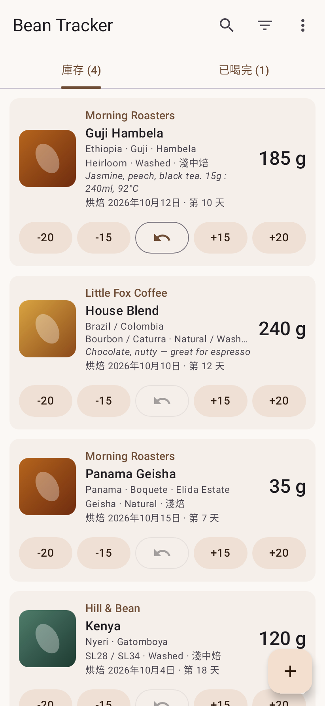
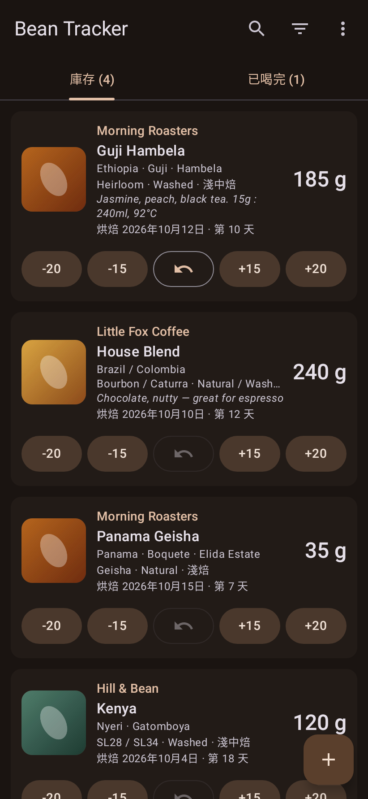
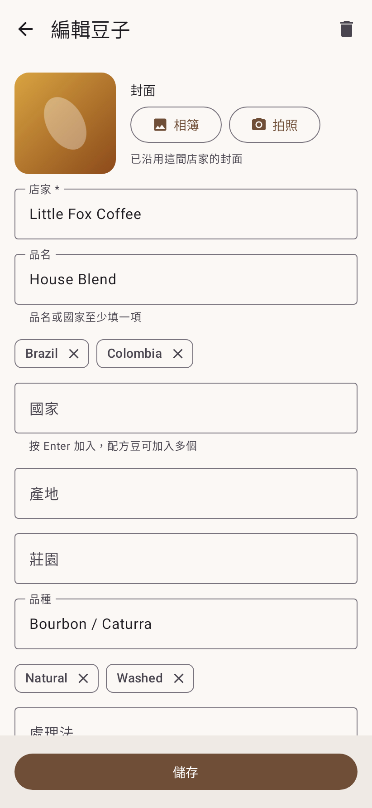

# Bean Tracker

Android app for tracking how much of each bag of coffee beans is left.
記錄每包咖啡豆剩餘克數的 Android App。

| 清單 | 深色模式 | 編輯 |
|---|---|---|
|  |  |  |

## 安裝 Install

1. 在手機上打開 [Releases](../../releases/latest)，下載最新的 `BeanTracker-x.y.z.apk`。
2. 點下載好的 APK。第一次安裝時 Android 會要求允許「安裝不明應用程式」，請允許給你用來開啟 APK 的瀏覽器或檔案管理員。
3. 點「安裝」。

**更新：** 下載新版 APK 直接安裝即可覆蓋，資料會保留。
如果出現「與現有套件衝突」，代表手機上是 v1.0.10 之前的舊版（簽章不同），請先移除再安裝；移除會清除 App 內的資料。

需求：Android 8.0 以上。

---

1. On your phone, open [Releases](../../releases/latest) and download the latest `BeanTracker-x.y.z.apk`.
2. Open the APK. The first time, Android asks you to allow installing unknown apps for your browser or file manager; allow it.
3. Tap Install.

**Updating:** install a newer APK over the existing app; your data is kept.
If Android reports a conflict with the existing package, you have a build older than v1.0.10, which was signed with a different key: uninstall it first (this deletes its data).

Requires Android 8.0 or later.

## Features 功能

- Roaster, cover, name, countries, region, farm, variety, process, roast date, remaining grams
- Multiple countries and processes per bag, for blends; roaster plus a name or a country is required
- Quick buttons on every card: `-20` `-15` `undo` `+15` `+20`; grams never go below 0
- Covers belong to the roaster: reusing a roaster name reuses its cover, and changing it updates every bag from that roaster
- Bags at 0 g move to the Finished tab (on the next refresh, so a mistaken tap can still be undone in place)
- Sorted by most recent use, with search and filters by roaster, country and process
- Light/dark theme (follow system or set by hand), English and Traditional Chinese

## Build

Every push to `main` builds a signed release APK in GitHub Actions and attaches it to a GitHub release.
Locally: `./gradlew assembleRelease` (needs the Android SDK).

Screenshots are rendered from the real screens with sample data by `ScreenshotTest`
(Robolectric + Roborazzi). Regenerate them with `./gradlew recordRoborazziDebug`, or run the
**Update screenshots** workflow, which commits the new images.

## License

MIT, see [LICENSE](LICENSE).
